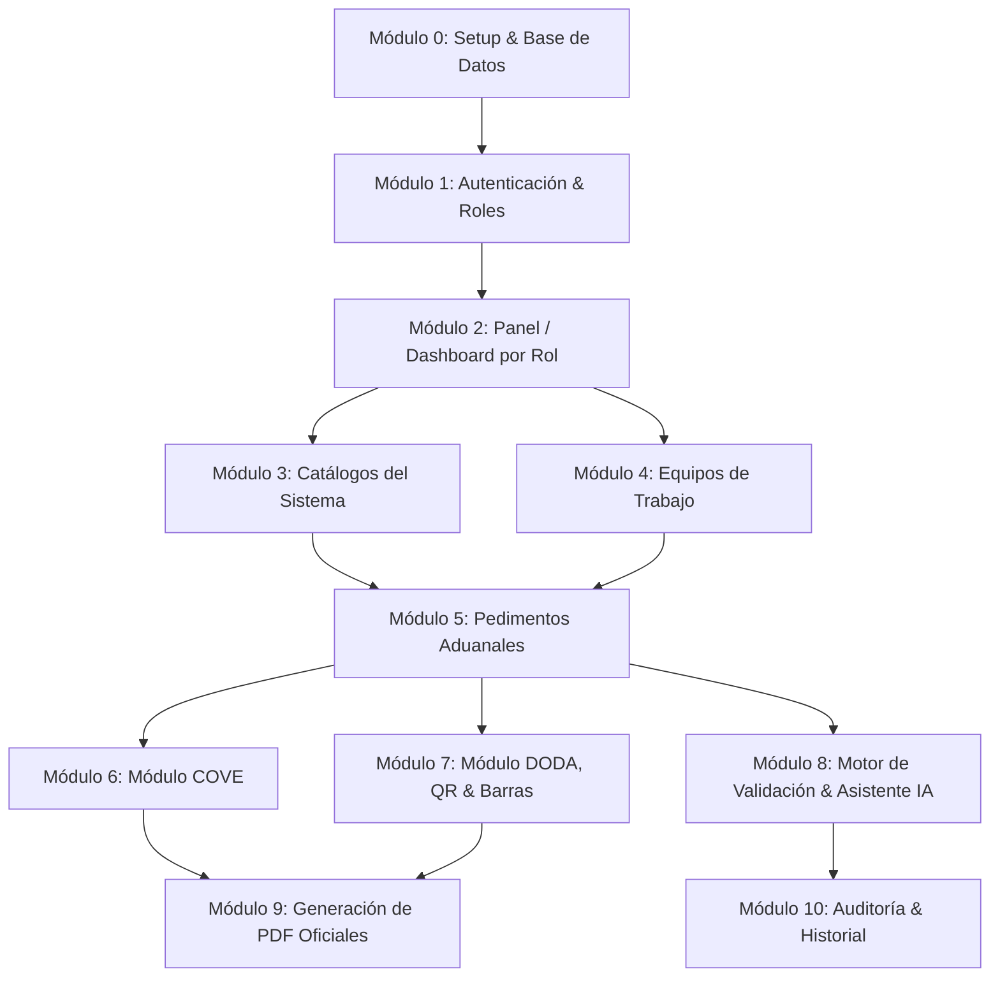

# Guía de Migración de SEPA a Laravel (Paso a Paso por Módulos)

Este documento detalla el plan maestro y la hoja de ruta técnica para migrar el sistema aduanero **SEPA** (actualmente en PHP Nativo / Procedural) a **Laravel 11+** siguiendo una arquitectura modular, mantenible y escalable.

---

## 📋 Resumen del Proyecto y Roles

### Roles del Sistema Identificados:

- **`admin` / `encargado` / `administrador`**: Acceso total al sistema, catálogos, gestión de usuarios, equipos y asignaciones.
- **`revisor`**: Consulta global de pedimentos, COVEs, DODA y validaciones; sin permisos de edición sobre documentos de terceros.
- **`usuario` / `capturista`**: Creación y edición únicamente de documentos y pedimentos propios o asignados a su equipo.

---

## 🗺️ Mapa de Ruta por Módulos



---

## 🛠️ Módulo 0: Preparación del Entorno y Base de Datos

### 1. Inicialización de Laravel

```bash
composer create-project laravel/laravel sepa-laravel
cd sepa-laravel
```

### 2. Dependencias Requeridas

```bash
# Autenticación y plantillas Blade
composer require laravel/breeze --dev
php artisan breeze:install blade

# Generación de PDFs
composer require barryvdh/laravel-dompdf

# Códigos QR y Códigos de Barras
composer require endroid/qr-code
composer require picqer/php-barcode-generator

# Soporte HTTP / IA
composer require openai-php/laravel -W
```

### 3. Migraciones de Base de Datos

Convertir los archivos SQL (`sepa/database/sepa_completo.sql` y `sepa/ADUANASIM.sql`) en migraciones de Laravel:

- `create_usuarios_table` (o actualizar `users` agregando campos: `rol`, `activo`, `telefono`).
- `create_equipos_table` y pivote `create_equipo_usuario_table`.
- `create_cat_aduanas_table` y `create_cat_monedas_table`.
- `create_pedimentos_table` y `create_pedimento_partidas_table`.
- `create_coves_table` y `create_cove_facturas_table`.
- `create_doda_table`.
- `create_historial_cambios_table`.

---

## 🔐 Módulo 1: Login y Autenticación por Rol

### Objetivo:

Sustituir [`sepa/login.php`](file:///home/lozada/Documentos/VS_Code/sepa/login.php), [`sepa/auth/login_process.php`](file:///home/lozada/Documentos/VS_Code/sepa/auth/login_process.php) y [`sepa/auth/middleware.php`](file:///home/lozada/Documentos/VS_Code/sepa/auth/middleware.php) por el stack oficial de autenticación de Laravel con control de roles.

### Tareas:

1. **Modelo `User`:**
   - Agregar casteo y métodos auxiliares:
     ```php
     public function isAdmin(): bool {
         return in_array($this->rol, ['admin', 'encargado', 'administrador']);
     }
     public function isRevisor(): bool {
         return $this->rol === 'revisor';
     }
     ```

2. **Middleware de Roles (`EnsureUserHasRole`):**

   ```bash
   php artisan make:middleware CheckRole
   ```

   - Validar que el usuario esté activo (`activo == 1`) y que posea el rol adecuado para la ruta.

3. **Redirección dinámica tras Login:**
   - En `AuthenticatedSessionController`, redirigir al dashboard según el rol del usuario.

4. **Vistas Blade:**
   - Adaptar diseño corporativo de SEPA en `resources/views/auth/login.blade.php`.

---

## 📊 Módulo 2: Panel / Dashboard por Rol

### Objetivo:

Reemplazar [`sepa/dashboard/index.php`](file:///home/lozada/Documentos/VS_Code/sepa/dashboard/index.php) y centralizar el layout (`header.php`, `sidebar.php`, `footer.php`).

### Tareas:

1. **Layout Maestro Blade (`resources/views/layouts/app.blade.php`):**
   - Menú lateral dinámico: condicionado con directivas `@if(auth()->user()->isAdmin())`, `@can`, etc.
2. **Controlador del Dashboard (`DashboardController`):**
   - **Para `admin`**: Resumen total de pedimentos del mes, usuarios activos, COVEs generados, alertas de validación.
   - **Para `revisor`**: Pedimentos pendientes de revisión, historial de dictámenes.
   - **Para `usuario`**: Mis pedimentos en captura, pedimentos validados, accesos rápidos a nuevo pedimento/COVE.

---

## 🗂️ Módulo 3: Catálogos del Sistema (Aduanas, Monedas, etc.)

### Objetivo:

Migrar [`sepa/catalogos/`](file:///home/lozada/Documentos/VS_Code/sepa/catalogos) y [`sepa/includes/catalogo_aduanas.php`](file:///home/lozada/Documentos/VS_Code/sepa/includes/catalogo_aduanas.php).

### Tareas:

1. **Modelos y Migraciones:** `Aduana`, `Moneda`, `TipoOperacion`, `ClavePedimento`.
2. **Seeders:** Crear `CatalogoSeeder` a partir de `ADUANASIM.sql` para poblar automáticamente los catálogos en cualquier ambiente.
3. **Endpoints de Autocompletado:**
   - API endpoints ligeros (`/api/catalogos/aduanas`, `/api/catalogos/monedas`) para selects dinámicos con búsqueda AJAX/Fetch.

---

## 👥 Módulo 4: Gestión de Usuarios y Equipos de Trabajo

### Objetivo:

Migrar [`sepa/usuarios/`](file:///home/lozada/Documentos/VS_Code/sepa/usuarios) y [`sepa/equipos/`](file:///home/lozada/Documentos/VS_Code/sepa/equipos).

### Tareas:

1. **`UserController` (Resource):**
   - Listado con filtros, creación, edición y cambio de estado (`activo`/`inactivo`).
2. **`EquipoController`:**
   - Gestión de grupos de trabajo, asignación de integrantes (`agregar_usuario.php`, `quitar_usuario.php`).
   - Definir relación Many-to-Many (`belongsToMany`) en el modelo `User` y `Equipo`.
3. **Políticas de Autorización (Policies):**
   - Asegurar que solo administradores puedan alterar roles o desactivar cuentas.

---

## 📦 Módulo 5: Pedimentos Aduanales (Núcleo Operativo)

### Objetivo:

Migrar el flujo completo de [`sepa/pedimentos/`](file:///home/lozada/Documentos/VS_Code/sepa/pedimentos).

### Tareas:

1. **Modelos:**
   - `Pedimento` (cabecera: número de pedimento, tipo de operación, aduana, patente, cliente, estatus).
   - `PedimentoPartida` (fracción arancelaria, NICO, descripción, valor comercial, valor aduana, tasas, contribuciones).
2. **`PedimentoController`:**
   - `index`: Listado paginado con filtros (por fecha, aduana, estatus y filtrado por usuario/equipo según el rol).
   - `create` / `store`: Formulario con validación vía FormRequest (`StorePedimentoRequest`).
   - `edit` / `update`: Actualización de partidas en vivo o mediante formularios anidados.
3. **Scopes de Eloquent para Permisos:**
   - `scopeVisiblesParaUsuario($query, $user)` para replicar la lógica de [`puedeVerPedimento()`](file:///home/lozada/Documentos/VS_Code/sepa/includes/permisos.php#L49).

---

## 📑 Módulo 6: Módulo COVE (Comprobante de Valor Electrónico)

### Objetivo:

Migrar [`sepa/cove/`](file:///home/lozada/Documentos/VS_Code/sepa/cove).

### Tareas:

1. **Modelos y Relaciones:** `Cove`, `CoveFactura`, `CoveMercancia`. Relación opcional con `Pedimento`.
2. **`CoveController`:**
   - Flujo de creación: datos del emisor, destinatario, relación de facturas y mercancías.
   - Finalización de captura y bloqueo de edición (`finalizar.php`).
3. **Exportación XML/E-Document:**
   - Servicio para estructurar el payload SOAP/XML según el estándar de VUCEM.

---

## 🏷️ Módulo 7: Módulo DODA, Códigos de Barras y Códigos QR

### Objetivo:

Migrar [`sepa/doda/`](file:///home/lozada/Documentos/VS_Code/sepa/doda) y [`sepa/qr/`](file:///home/lozada/Documentos/VS_Code/sepa/qr).

### Tareas:

1. **Servicio `DodaService` (`app/Services/DodaService.php`):**
   - Generación de cadena para código bidimensional QR según lineamientos del SAT/Aduanas.
   - Generación de código de barras unidimensional (Code 128) con `picqer/php-barcode-generator`.
2. **`DodaController`:**
   - Creación y consulta de DODA asociado a uno o varios pedimentos.
   - Integración visual del código QR generado dinámicamente o en base64 en la vista.

---

## 🤖 Módulo 8: Motor de Validación y Asistente con IA

### Objetivo:

Migrar la lógica de validación de pedimentos y la integración OpenAI de [`sepa/validacion/`](file:///home/lozada/Documentos/VS_Code/sepa/validacion) y [`sepa/ia/`](file:///home/lozada/Documentos/VS_Code/sepa/ia).

### Tareas:

1. **Servicio de Validación de Reglas (`PedimentoValidationService`):**
   - Migrar [`sepa/validacion/reglas.php`](file:///home/lozada/Documentos/VS_Code/sepa/validacion/reglas.php): validación de RFC, cálculo correcto de contribuciones (IGI, DTA, IVA), correlación entre régimen y clave de pedimento.
2. **Servicio `OpenAiService` (`app/Services/OpenAiService.php`):**
   - Configuración en `config/services.php` leyendo `OPENAI_API_KEY` desde `.env`.
   - Métodos para análisis predictivo de inconsistencias y chat contextual (`chat.php`).
3. **Endpoint de Validación:**
   - `POST /pedimentos/{id}/validar`: Ejecuta reglas sintácticas y consulta opcional con IA, retornando reporte de advertencias/errores en JSON o vista modal.

---

## 🖨️ Módulo 9: Generación de Documentos y Reportes en PDF

### Objetivo:

Migrar [`sepa/pdf/`](file:///home/lozada/Documentos/VS_Code/sepa/pdf).

### Tareas:

1. **Servicio `PdfService` (`app/Services/PdfService.php`):**
   - Encapsular la configuración de DomPDF (márgenes, formato carta, imágenes base64 para QR/código de barras).
2. **Vistas Blade para Formatos Impresos:**
   - `resources/views/pdf/pedimento_completo.blade.php`.
   - `resources/views/pdf/pedimento_simplificado.blade.php`.
   - `resources/views/pdf/doda.blade.php`.
   - `resources/views/pdf/cove.blade.php`.
3. **Descarga y Previsualización Stream:**
   - `return $pdf->stream('pedimento-'.$folio.'.pdf');` o `$pdf->download(...)`.

---

## 📜 Módulo 10: Auditoría, Historial y Despliegue

### Objetivo:

Migrar [`sepa/historial/`](file:///home/lozada/Documentos/VS_Code/sepa/historial) y puesta a punto final.

### Tareas:

1. **Observers o Activity Log:**
   - Registrar eventos en pedimentos (quién creó, quién modificó, quién validó y cambios de estado).
2. **Optimización para Producción:**
   - `php artisan config:cache`
   - `php artisan route:cache`
   - `php artisan view:cache`
3. **Pruebas End-to-End:**
   - Validación cruzada de datos con las bases de respaldo existentes en `sepa/*.sql`.

---

## 📌 Checklist de Ejecución Rápida

- [ ] **Módulo 0**: Inicializar Laravel 11, configurar `.env`, instalar librerías y armar migraciones.
- [ ] **Módulo 1**: Implementar login con roles (`admin`, `revisor`, `usuario`) y middleware de acceso.
- [ ] **Módulo 2**: Construir el layout principal y dashboards segmentados por rol.
- [ ] **Módulo 3**: Cargar catálogos (aduanas, monedas) vía Seeders.
- [ ] **Módulo 4**: Módulo CRUD de usuarios y gestión de equipos.
- [ ] **Módulo 5**: CRUD de Pedimentos y cálculo de Partidas con políticas de acceso.
- [ ] **Módulo 6**: Módulo COVE con facturación y captura de mercancías.
- [ ] **Módulo 7**: Módulo DODA con generador de QR y códigos de barra.
- [ ] **Módulo 8**: Validación de reglas aduaneras e integración con OpenAI.
- [ ] **Módulo 9**: Renderizado e impresión de PDFs oficiales con DomPDF.
- [ ] **Módulo 10**: Historial de movimientos, pruebas y migración de datos.
